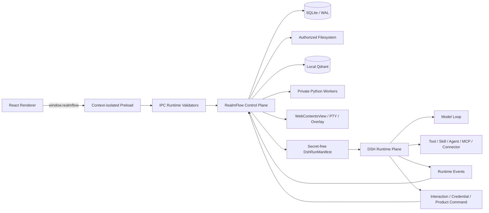

# RealmFlow

RealmFlow 是一个本地优先的 AI 工作流桌面客户端。它以空间、需求、流程模板和对话为核心，在 Electron Main 中管理本地业务状态、文件、权限、知识索引与运行审计，并将 Agent 执行委托给 DSH Runtime Plane。

当前版本为 `0.1.0`。仓库已经实现可运行的桌面客户端、Main-owned SQLite 业务存储、受管工作目录、工作流 DAG、通用与节点对话、本地知识库、能力目录、工作台中心、文档工具链，以及 DSH-native Agent Runtime 集成。

## 已实现能力

### 工作台与导航

- 可折叠、可调整宽度的左侧导航，包含空间、需求和最近对话。
- 最近对话使用 Main-owned 游标查询，默认每批 50 条并支持触底加载。
- 会话详情首次加载最新 15 个 Turn，向上滚动时继续加载历史并保持滚动锚点。
- 工作台中心包含：
  - 工作台概览：空间进展、进行中需求、最近结果与异常中心。
  - 任务待办：自定义表、字段、记录、视图、筛选、排序、分组和附件。
  - 常用网站：分组、排序与隔离网页打开。
  - 定时任务：本地 Cron 调度、暂停、恢复、立即运行和历史记录。
  - 备忘录：本地富文本编辑、图片与文件附件。
  - 终端：基于 `node-pty` 和 xterm.js 的本地终端会话。
- 工作台 Tab 顺序与显隐由 Main 持久化，支持名称拖拽排序和 revision 冲突处理。

### 对话与 AI 运行

- 支持普通对话、空间对话、文件夹上下文对话和需求节点对话。
- 支持文本、图片和文档附件；附件先在本地落盘并完成校验与内容抽取，再按模型能力决定是否允许图片出站。
- 支持 PNG、JPEG、WebP、GIF 及 PDF、DOCX、XLSX、PPTX、Markdown 等本地内容抽取。
- 对话支持：
  - 模型、推理模式和权限档位选择。
  - 谨慎确认、自动防护和受信任执行三种审批策略。
  - Tool、Skill、Agent、Subagent、MCP 和 Connector 执行时间线。
  - 会话内搜索、跟进建议、知识笔记沉淀和分享卡片。
  - 用户附件点击后经 Main 校验，在右侧工作区打开。
- Agent Runtime 使用 Goal、预算、委派、权限等待和公开事件投影维护可恢复运行状态。
- 应用重启后会恢复具备安全检查点的运行，或将无法安全继续的运行标记为中断并保留诊断。

### 空间、需求与流程

- 工作根、空间和需求目录由 Main 管理，并通过 `.realmflow` 清单保存稳定身份。
- 空间和需求支持创建、展示名称修改、显式物理目录重命名、垃圾箱删除、恢复和永久清理。
- 空间目录移动后可通过身份清单重新定位，需求派生路径在同一事务中更新。
- 流程模板支持创建、复制、编辑、发布、归档和不可变版本。
- DAG 编辑器支持节点、连线、位置、并行度、产物、待办、问题、审批和权限配置。
- 新建需求时选择已发布模板版本，并实例化独立的需求流程。
- 需求流程支持：
  - 节点状态机和稳定就绪队列。
  - 并行节点执行。
  - 待办、问题、审批和完成门禁。
  - 执行、暂停、恢复、取消、重试、跳过和回滚。
  - 已执行节点保护、实例修订和模板迁移。
  - 启动恢复、审计事件和执行视图。
- 正式产物只有在文件校验与 SQLite 事务全部成功后才提交；重复提交保持幂等。

### 本地知识库

- 支持本地文件、在线文档、代码仓库、知识笔记和需求记忆。
- 知识源采用命令、事件、快照、刷新游标、索引作业和 generation 指针维护生命周期。
- 正式需求产物可同步回所属空间知识库。
- SQLite 是知识业务状态的唯一事实来源。
- 本地 Qdrant 是可重建投影，提供 Dense + BM25 混合检索。
- 默认本地向量模型为 `Alibaba-NLP/gte-multilingual-base`，由 DSH-owned 私有 Python worker 通过 stdio 执行，不开放 HTTP 服务。
- 每次运行只向 DSH 发布当前作用域允许的知识快照、generation 和索引租约。

### 能力目录与文档工具

- 能力页面统一管理 Tool、Skill、Agent 和 Connector。
- 支持内置目录同步、能力创建、扩展包导入、版本切换、启停、删除和引用保护。
- 当前内置目录包含 17 个扩展包、135 个 Tool 定义和 10 个核心 Skill，覆盖：
  - 文件、进程、Git、Web、浏览器和 Computer Use。
  - 知识、RealmFlow 产品命令、MCP 与 Connector。
  - 文档、表格、演示文稿、PDF、图片、固定版式和压缩包。
- 本地文档能力使用 revision-safe session：
  - DOCX、XLSX、PPTX 的检查、编辑、重算与保存。
  - PDF 的检查、表单、批注、OCR、合并、拆分、旋转和水印。
  - 图片的检查、OCR、裁剪、缩放、转换、压缩、合成和隐私处理。
  - 老式 Office 文件只通过安全副本导入，不覆盖原文件。

### 右侧工作区

- 应用级右侧工作区默认收起，页面内容按需打开文件、网页、终端或代码片段。
- 本地文件工作区支持目录树、多文件 Tab、Monaco Editor、Markdown、HTML、图片、PDF/OFD 等固定版式预览。
- 支持保存、`Command/Ctrl + S`、外部修改冲突检测和 Finder 定位。
- HTTP/HTTPS 链接在隔离的 `WebContentsView` 中打开。
- 工作区在页面切换时保持打开，并保留宽度、Tab 和未保存编辑状态。
- 最大化右侧工作区时保留左侧导航，面板几何由统一 Workbench Provider 管理。

### 配置、统计与恢复

- 模型设置支持 Provider、模型档案、凭据、能力、默认模型、启停和可用性验证。
- 模型密钥使用应用私有 keyring 加密，不写入环境变量、日志或工作目录。
- 统计分析包含产品活动、模型调用和运行治理。
- 运行治理支持失败定位、公开事件轨迹、脱敏诊断导出、固定评测和候选配置发布。
- 支持本地备份、恢复预览、校验和验证及启动前恢复。
- 支持简体中文、English、日本语，以及亮色、暗色和跟随系统主题。
- 支持版本检查、本地帮助和反馈入口。

## 运行时架构



RealmFlow 分为两个明确边界：

- **RealmFlow Control Plane**：拥有产品状态、SQLite、凭据、知识源、权限策略、工作流、文件事务和用户交互。
- **DSH Runtime Plane**：拥有模型循环、Tool、Skill、Subagent、MCP、Connector、compaction 和低层运行历史。

两者只通过不可变、无密钥的 `DshRunManifest`，以及 Interaction Bridge、Credential Broker、Product Command API、Knowledge Index Port 和 Runtime Event Ingestor 交互。

| 层级 | 技术与职责 |
| --- | --- |
| 领域层 | `domain/` 中与进程无关的业务模型、状态机和校验 |
| Renderer 应用层 | Reducer、Port、Controller Hook、路由和视图组合 |
| 类型化边界 | `shared/` 契约、Preload 白名单和 Main 运行时校验 |
| Main 应用层 | Command / Query Use Case、事务协调、权限和恢复 |
| Main 基础设施 | SQLite Repository、Qdrant、DSH supervisor、文件和网络适配器 |
| Agent Runtime | 固定版本 DSH Runtime 与 RealmFlow Runtime Plugin |
| 本地计算 | 受限 stdio Python worker，处理 embedding、Office 和文档纯计算 |
| 桌面容器 | Electron 30、React 18、React Router 7、electron-vite |
| 测试与守卫 | Vitest、Testing Library、Python pytest、架构和组件系统守卫 |

Renderer 保持低权限：

```text
sandbox: true
contextIsolation: true
nodeIntegration: false
webSecurity: true
```

Renderer 不直接访问 Node.js、SQLite、Qdrant、DSH、私有 worker 或文件系统。所有特权操作均通过类型化 IPC 进入 Electron Main。

详细依赖方向、状态归属和运行时边界见 [`docs/architecture.md`](docs/architecture.md)。

## 数据与文件

应用私有数据位于：

```text
app.getPath('userData')/
├── realmflow.db
├── model-credentials.key
├── web-credentials.key
├── qdrant/
├── dsh/
├── conversation-attachments/
└── content-extraction-cache/
```

用户选择的工作根采用受管目录：

```text
<work-root>/
├── .realmflow/
│   ├── root.json
│   ├── tmp/
│   └── trash/
└── <space-name>--<stable-id>/
    ├── .realmflow/space.json
    └── <requirement-name>--<stable-id>/
        ├── .realmflow/requirement.json
        ├── artifacts/
        ├── attachments/
        └── workspace/
```

| 数据 | 所有者与存储 |
| --- | --- |
| 工作根、空间、需求、流程和运行状态 | Electron Main / SQLite |
| 对话 Turn、附件、投影和搜索索引 | Electron Main / SQLite 与应用私有目录 |
| 模型、能力、Connector、MCP 和凭据 | Electron Main / SQLite + mode `0600` keyring |
| 工作台任务、网站、备忘录和布局 | Electron Main / SQLite |
| 知识源、作业、快照和 generation | Electron Main / SQLite |
| Dense/BM25 检索投影 | 本地 Qdrant，可从 SQLite 重建 |
| 正式产物和用户工作文件 | 受管空间与需求目录 |
| DSH Session 与低层运行历史 | DSH Runtime 私有目录 |
| 侧栏宽度等纯 UI 偏好 | Renderer `localStorage` |

SQLite 启用外键、WAL、`busy_timeout`、原生 Migration 和 revision CAS。可并发修改的聚合必须携带期望 revision，过期写入不会静默覆盖新状态。

空间、需求和正式产物写入使用文件系统与 SQLite 协调事务。失败时回滚数据库、恢复原文件并清理临时目录。

## 安全边界

- Main 在每次文件操作前规范化真实路径，拒绝目录穿越和越界符号链接。
- 文件、终端、浏览器、MCP 和 Connector 调用都经过作用域、风险和审批策略。
- DSH Manifest 不包含 API Key；模型和 Connector 凭据按调用通过 Credential Broker 提供。
- Qdrant 只监听 loopback，使用进程级随机 API Key。
- Renderer、DSH 插件和私有 Python worker 均不能直接访问 SQLite。
- IPC 不接受任意 SQL，也不暴露数据库路径、Statement 或连接对象。
- HTML 预览禁用脚本、网络、表单、弹窗和 Node.js 能力。
- 隔离网页视图只允许 HTTP/HTTPS，并拒绝权限、弹窗和任意下载。
- 用户选择的文件夹会在每次运行前重新校验，不隐式扩展为全盘权限。
- 图片只有在用户提交且模型支持视觉时才允许出站；文档优先使用本地抽取文本。
- 正式产物路径、类型、Run 身份和事件序列都由 Main 再次校验。

## 环境要求

- Node.js 20 或更高版本。
- npm。
- Python 3.11 或更高版本。
- 当前完整运行与打包基线：macOS Apple Silicon。
- Xcode Command Line Tools，仅在执行 macOS 打包时需要。

DSH Runtime 自带固定 Node 运行时，不复用用户系统 Node。当前 `runtime-manifest.json` 已填充 `darwin-arm64` 资源，其他平台条目仍是预留清单。

## 本地开发

安装 Node.js 依赖：

```bash
npm install
```

创建私有 Python worker 环境：

```bash
python3.11 -m venv python-service/.venv
source python-service/.venv/bin/activate
python -m pip install -r python-service/requirements.txt
python -m pip install "pytest>=8.3,<9.0"
```

首次克隆或本地资源缺失时准备 Qdrant 和 GTE 模型：

```bash
npm run download:qdrant
npm run download:gte-model
npm run verify:qdrant-assets
npm run verify:gte-model
```

启动 Electron 开发环境：

```bash
npm run dev
```

`npm run dev` 会先将 `better-sqlite3` 和 `node-pty` 重建为 Electron ABI。`npm test` 会将它们恢复为当前 Node.js ABI，因此测试后再次启动开发环境会重新执行 Electron rebuild。

开发模式优先使用 `python-service/.venv/bin/python`。也可以显式指定：

```bash
REALMFLOW_PYTHON=/path/to/python npm run dev
```

需要刷新固定 DSH Runtime 时执行：

```bash
npm run fetch:dsh-runtime
npm run verify:dsh-runtime
```

## 常用命令

```bash
# TypeScript 类型检查
npm run typecheck

# Node / Renderer / Electron 测试
npm test

# 测试监听模式
npm run test:watch

# Python worker 测试
python-service/.venv/bin/python -m pytest python-service/tests

# 生产构建；包含目录、Tool、CSS、组件和类型守卫
npm run build

# 内置扩展与 Tool 契约
npm run verify:builtin-catalog
npm run verify:tool-contracts

# DSH Runtime 架构与资源
npm run verify:dsh-runtime-architecture
npm run verify:dsh-runtime
npm run verify:dsh-package-layout

# Qdrant、GTE 与知识检索
npm run verify:qdrant-assets
npm run verify:gte-model
npm run benchmark:knowledge
npm run verify:knowledge-benchmark

# 原生模块与 Electron SQLite
npm run rebuild:native
npm run verify:sqlite
```

## macOS 打包

生成当前 Apple Silicon 发布产物：

```bash
npm run dist:mac
```

输出位于 `release/`：

```text
release/mac-arm64/RealmFlow.app
release/RealmFlow-0.1.0-arm64.pkg
release/RealmFlow-0.1.0-arm64.zip
```

打包流程会构建 DSH Runtime 资源、生成 SBOM、执行生产构建、验证 DSH 包布局，再对 `.app` 做本地临时签名并生成 PKG/ZIP。当前尚未接入 Apple Developer ID 和公证，不应将该命令等同于正式发布流程。

## 项目结构

```text
.
├── domain/                          # 进程无关领域内核
├── shared/                          # Renderer / Preload / Main 共享契约
├── src/
│   ├── app/                         # 路由装配与 Controller Hooks
│   ├── application/                 # Renderer Port、Reducer 和状态机
│   ├── components/                  # 共享组件系统
│   ├── features/                    # 对话、工作台、知识、能力、流程等功能
│   ├── infrastructure/storage/      # Renderer 兼容读取适配器
│   └── pages/                       # 页面组合
├── electron/src/
│   ├── main.ts                      # Main Composition Root
│   ├── preload.ts                   # Context-isolated 类型化桥接
│   ├── application/                 # Main Use Case、Port 和业务服务
│   │   ├── conversation/            # 对话与 Turn 生命周期
│   │   ├── dsh/                     # Manifest、Bridge 与事件投影
│   │   ├── workflow/                # DAG、节点、门禁和恢复
│   │   ├── knowledge/               # 知识源、刷新和索引协调
│   │   ├── capabilities/            # 能力目录与包生命周期
│   │   ├── files/                   # 文档、PDF、图片和 Office session
│   │   └── workbench-hub/           # 工作台业务服务
│   ├── bootstrap/                   # DSH Control Plane 组合
│   ├── infrastructure/
│   │   ├── sqlite/                  # Schema、Repository 和 UnitOfWork
│   │   └── dsh/                     # ACP client、locator 和 supervisor
│   ├── ipc/                         # Channel 注册和运行时校验
│   ├── qdrant/                      # 本地 Qdrant 进程管理
│   ├── workspace/                   # 安全文件与受管目录
│   ├── workbench/                   # Web、终端和原生工作区
│   └── terminal/                    # node-pty 会话管理
├── dsh-plugins/realmflow-runtime/   # RealmFlow DSH Runtime Plugin
├── python-service/                  # 私有 Python worker 与纯计算服务
├── resources/
│   ├── extensions/builtin/          # 内置 Tool / Skill 扩展包
│   ├── dsh/                         # 固定 DSH Runtime、Profile 和 SBOM
│   └── qdrant/                      # 平台 Qdrant 二进制
├── scripts/                         # 构建、校验、下载和基准脚本
├── docs/                            # 架构、需求、设计与测试报告
└── build/electron-builder.yml       # Electron 打包配置
```

## 当前边界

- 当前完整打包资源只覆盖 macOS Apple Silicon；Windows、Linux 和其他架构仍需补齐 DSH、Qdrant 与本地模型资产。
- 模型、在线文档、远程仓库、Web 搜索和 Connector 需要网络及用户配置的凭据。
- 右侧文件工作区当前不提供通用的文件创建、重命名和删除 UI；这些写操作通过受控产品命令或内置 Tool 执行。
- HTML 预览以安全优先，不执行 JavaScript，也不访问外部网络。
- 本地 Qdrant 是可重建索引，不应作为业务事实来源或直接由 Renderer、DSH 插件修改。

## 进一步阅读

- [产品架构](docs/product-architecture.md)
- [工程架构](docs/architecture.md)
- [原子需求索引](docs/product-requirements/README.md)
- [测试报告](docs/test-reports/)
- [第三方依赖声明](THIRD_PARTY_NOTICES.md)

## License

[MIT](LICENSE)
